<p align="center">
  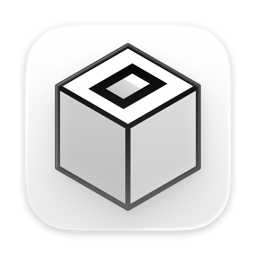
</p>

<h1 align="center">OpenChamber for Droppy</h1>

<p align="center">
  Your <a href="https://github.com/openchamber/openchamber">OpenChamber</a> coding sessions, approvals and plan usage, right in the notch.
</p>

<p align="center">
  
  
  
  
  
</p>

<p align="center">
  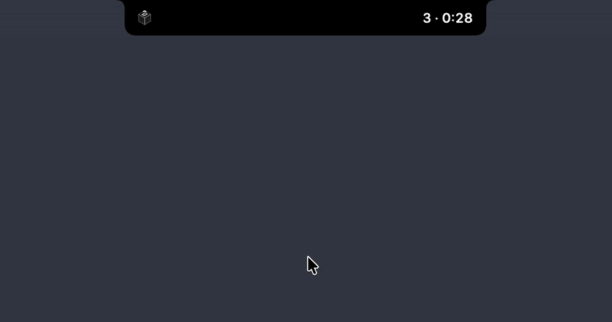
</p>

A [Droplet](https://getdroppy.app/docs/droppykit) for [Droppy](https://getdroppy.app), the
Dynamic Island and shelf for Mac. It watches every OpenChamber server your Mac knows about
and puts what your agents are doing beside the notch, so you can stop alt-tabbing to check
whether a session is done, stuck or waiting on you.

## What it does

### Sessions, narrated

<p align="center">
  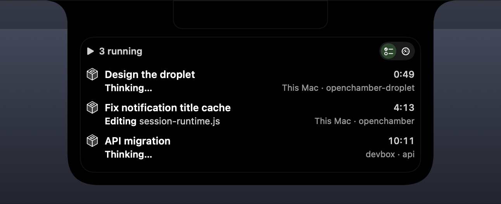
</p>

Every running session gets a row: its title, what it is doing in plain words (*Running
swift test*, *Editing Views.swift*, *Thinking…*), the server and project it runs in, and how
long the turn has taken. Sessions from this Mac and your remote hosts sit side by side.
Hover what a session is doing to read the whole command and its last message; click a
session to open it in OpenChamber Desktop, on the right host.

### Approvals without switching apps

<p align="center">
  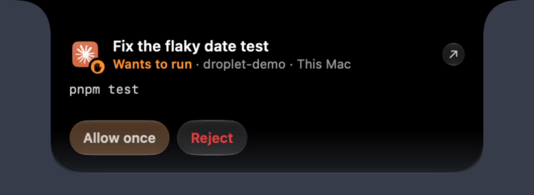
</p>

When an agent asks for permission, a card drops from the notch with the exact command.
Allow it once or reject it and keep working. The card stays until you answer, and the
widget keeps every pending request, with **Always** for the ones you trust.

<p align="center">
  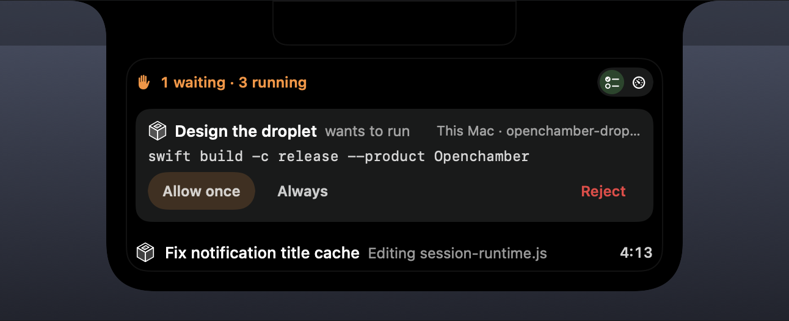
</p>

Cards also tell you when a turn ends, fails or asks you a question. They stay quiet while
OpenChamber is the app in front, and each kind has its own switch.

<p align="center">
  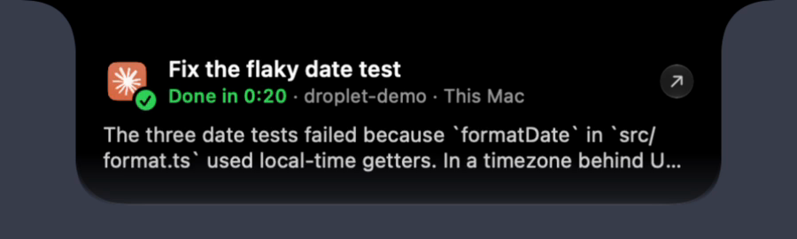
</p>

### Plan usage at a glance

<p align="center">
  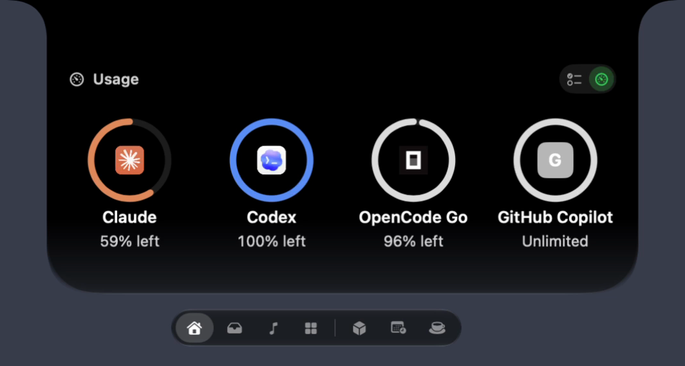
</p>

The Usage page shows a ring per provider with what is left of its tightest window. Hover a
ring for every window and when it resets. You get a notice on the notch as a window passes
80% and again at 95%.

### Everywhere else Droppy lives

<table>
  <tr>
    <td align="center" width="42%" rowspan="2">
      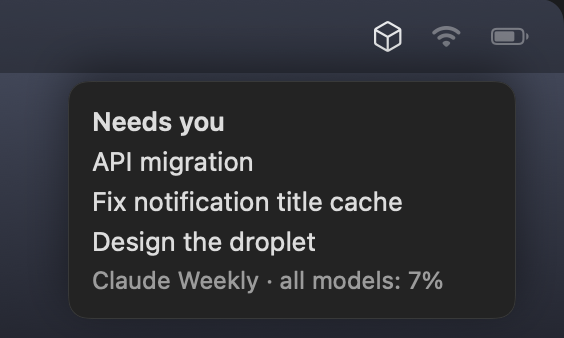<br>
      <sub><b>Menu bar</b>: where things stand, running sessions to jump into, your quota</sub>
    </td>
    <td align="center" width="58%">
      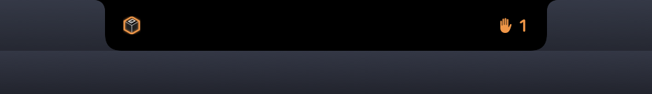<br>
      <sub><b>Live activity</b>: how many sessions need you, beside the notch</sub>
    </td>
  </tr>
  <tr>
    <td align="center">
      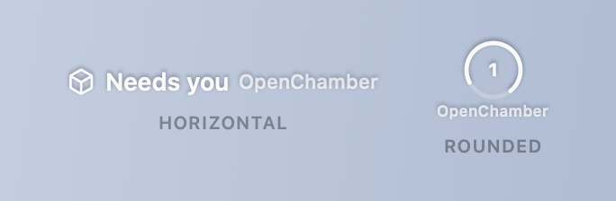<br>
      <sub><b>Lock screen</b>: a status row in both of Droppy's styles</sub>
    </td>
  </tr>
</table>

### Settings and shortcuts

<p align="center">
  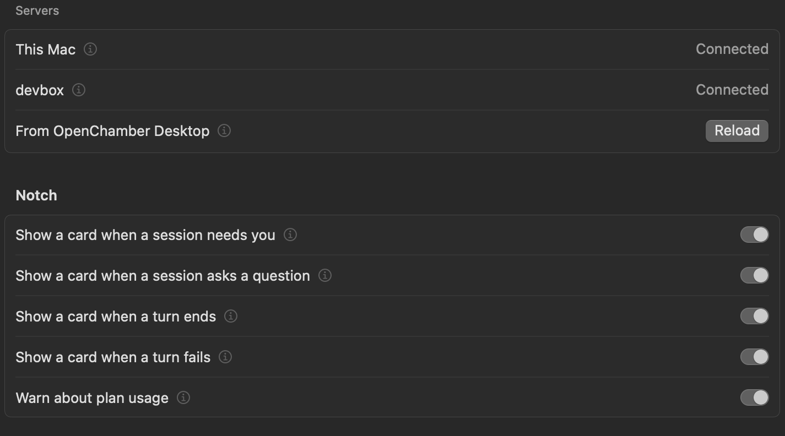
</p>

Droppy's settings page for the droplet lists every server with its connection state and has
a switch per kind of notch card. Two global shortcuts, which you bind in Droppy: **Allow the
oldest OpenChamber request once** and **Open the OpenChamber session that needs you**.

> [!NOTE]
> The animation and the card, Done and Usage pictures were recorded on a MacBook's notch,
> with demo sessions. The rest come from the DroppyKit harness with sample data.

## How it connects

There is nothing to pair. The droplet reads the servers
[OpenChamber Desktop](https://github.com/openchamber/openchamber) is already set up for in
`~/.config/openchamber/settings.json`: this Mac's own server and every remote host, with the
client tokens Desktop already holds. It talks to each one directly, or through OpenChamber's
end-to-end encrypted relay when no direct address answers.

- **REST** under `/api` for sessions, permission and question replies, and quotas.
- **Events** over `/api/global/event/ws`, resumed from the last event after a reconnect.
- **Opening a session** goes through `openchamber://session/<id>?host=<id>`, which Desktop
  opens on the instance that owns the session
  ([openchamber#5366](https://github.com/openchamber/openchamber/pull/5366), in releases
  after 2.5.0). With 2.5.0 and older, the droplet switches Desktop to the session's host first.

> [!IMPORTANT]
> This is a personal droplet. Reading Desktop's settings file and opening `openchamber://`
> links directly are shortcuts the Droplet Store would not accept, so it is not on the
> Store: you build it and load it yourself.

## Install

You need macOS 14 or later, [Droppy](https://getdroppy.app) 15.3 or later (or the free
[Droppy Playground](https://getdroppy.app/download/playground)), Xcode with Swift 6.2, and
OpenChamber Desktop set up with at least one server.

1. Get the DroppyKit CLI:

   ```bash
   git clone https://gitlab.com/droppyformac1/droppykit.git
   export PATH="$PWD/droppykit/Scripts:$PATH"
   ```

2. Build the droplet:

   ```bash
   git clone https://github.com/JosueGalRe/openchamber-droplet.git
   cd openchamber-droplet
   droppykit build    # writes .build/Openchamber.droplet
   ```

3. Load it. In Droppy, open **Settings → Store → Local droplets** and drop in
   `.build/Openchamber.droplet`. Droppy asks you to approve an unsigned build each time it
   launches. The Playground doesn't ask; copy the bundle in and relaunch it:

   ```bash
   dest="$HOME/Library/Application Support/Droppy Playground/Droplets/openchamber"
   mkdir -p "$dest" && rm -rf "$dest/Openchamber.droplet"
   cp -R .build/Openchamber.droplet "$dest/"
   ```

## Develop

```bash
swift test                              # unit tests
droppykit build && droppykit validate   # the bundle and the Store's checks
droppykit run                           # the harness, a page per surface

# every surface as a PNG, and a JSON verdict
droppykit run -- --shots ./shots --report ./shots/report.json
```

`OPENCHAMBER_LIVE_RELAY=1 swift test --filter liveRelay` runs one test against a real
remote host through the relay, with Desktop's settings on your Mac.

`scripts/demo-take.sh` records the animation at the top: it starts throwaway sessions on
this Mac's OpenChamber, asks for a permission mid-take, and records the display with
[OpenScreen](https://github.com/getopenscreen/openscreen) and ffmpeg. Its header says what it
needs.

| File | What's in it |
| --- | --- |
| `Sources/Openchamber/OpenchamberDroplet.swift` | The droplet: surfaces, notch cards, shortcuts, the harness sample |
| `Sources/Openchamber/OpenChamberClient.swift` | Desktop's servers, REST and the event socket |
| `Sources/Openchamber/RelayTunnel.swift` | The encrypted tunnel through OpenChamber's relay |
| `Sources/Openchamber/ActivityState.swift` | Wire events reduced to sessions, requests and narration |
| `Sources/Openchamber/Views.swift` | The widget, cards, usage rings and settings pane |
| `droplet.json` | The manifest; `Info.plist` is generated from it |

`AGENTS.md` is the brief for coding agents, and `.mcp.json` connects the DroppyKit MCP
server (build, validate, shots, install) for Claude Code and Cursor.

## License

[MIT](LICENSE). OpenChamber and Droppy are their authors' projects; this droplet isn't
affiliated with either.
